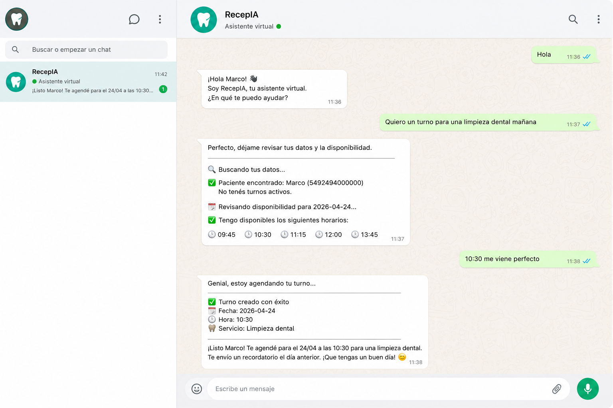
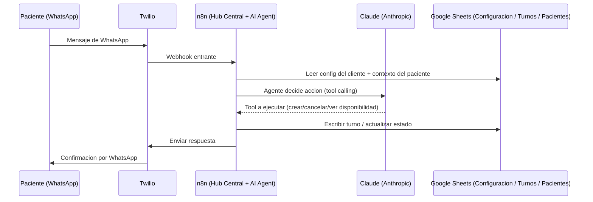

# RecepIA — Recepcionista con IA para negocios con turnos

Sistema de automatización WhatsApp (y voz) con inteligencia artificial para negocios que trabajan con turnos: clínicas, barberías, canchas, consultorios, veterinarias.

Un agente de IA (Claude) atiende por WhatsApp, entiende lenguaje natural, agenda/cancela/reprograma turnos, manda recordatorios y hace seguimiento — sin que el dueño del negocio tenga que responder mensajes.



---

## Qué hace

- **Agente conversacional** — el paciente escribe como le sale ("necesito turno para el jueves a la tarde") y el agente pregunta lo que falta, agenda, cancela o reprograma solo
- **Recordatorio automático** — el día anterior al turno le manda WhatsApp al cliente pidiendo confirmación
- **Reviews post-turno** — después del turno le pide opinión a quien asistió. Si es positiva, manda el link de Google
- **Multi-tenant** — un mismo flow atiende a varios negocios: cada cliente es una fila en una hoja de configuración (nombre, dirección, precios, tono, credenciales de Twilio)
- **Canal de voz (opcional)** — los mismos tools (crear/cancelar turno, ver disponibilidad) están expuestos como webhooks para un agente de voz en Vapi.ai

--

## Stack técnico

| Componente | Herramienta | Costo |
|---|---|---|
| Automatización | n8n en Contabo VPS | ~$7/mes |
| WhatsApp API | Twilio | Pago por conversación |
| Base de datos | Google Sheets | Gratis |
| IA | Claude (Anthropic) — Haiku para clasificar, Sonnet para generar | ~$0.001-0.01 por mensaje |
| Voz (opcional) | Vapi.ai + ElevenLabs | Pago por minuto |
| Cobro | Stripe o MercadoPago | % por transacción |

## Arquitectura



---

## Estructura del repo

```
RecepIA---n8n/
├── README.md
├── agente_demo.js                    ← demo de consola del agente (sin n8n, para probar la lógica)
├── build_agente.js                   ← genera flow2_agente_configurable.json
├── build_flow2.js                    ← genera la versión vieja (vapi/flow2_hub_central_v2.json)
├── dashboard.html                    ← prototipo standalone de dashboard
└── n8n-flows/
    ├── flow2_agente_configurable.json   ← versión ACTUAL: hub central con AI Agent nativo de n8n, multi-tenant
    ├── flow_error_handler.json          ← captura errores de cualquier flow y avisa
    ├── tool_crear_turno.json            ← sub-workflow, tool del agente
    ├── tool_cancelar_turno.json         ← sub-workflow, tool del agente
    ├── tool_cambiar_turno.json          ← sub-workflow, tool del agente
    ├── tool_ver_disponibilidad.json     ← sub-workflow, tool del agente
    ├── tool_buscar_contexto.json        ← sub-workflow, tool del agente
    └── vapi/
        ├── flow1_recordatorio_diario.json    ← versión ANTERIOR (pre-agente), single-tenant, de referencia
        ├── flow2_hub_central_v2.json         ← versión ANTERIOR, lógica de clasificación manual sin AI Agent
        ├── flow3_reviews_post_turno.json     ← versión ANTERIOR
        ├── flow_vapi_crear_turno.json        ← webhook para el agente de VOZ (Vapi.ai)
        ├── flow_vapi_cancelar_turno.json     ← webhook para el agente de VOZ
        ├── flow_vapi_disponibilidad.json     ← webhook para el agente de VOZ
        └── flow_vapi_obtener_fecha.json      ← webhook para el agente de VOZ
```

La versión que se usa hoy es `flow2_agente_configurable.json` + sus 5 tools + el error handler. La carpeta `vapi/` mezcla dos cosas distintas: los 3 flows viejos de WhatsApp (dejados de referencia) y los 4 webhooks que sí están en uso, pero para el canal de voz.

---

## Google Sheets — estructura requerida

Una hoja de cálculo con tres pestañas:

### "Configuracion" (multi-tenant: una fila por cliente)
Incluye, por cliente: `clinicaId`, nombre, dirección, teléfono, horario, servicios y precios, tono del agente (system prompt), y credenciales de Twilio (`twilioFrom`, `twilioAuth`, `twilioUrl`) para poder atender varios negocios desde el mismo flow.

### "Turnos"
| turno_id | fecha | hora | nombre | telefono | servicio | estado_turno |
|---|---|---|---|---|---|---|
| 5491123_2026-04-10 | 2026-04-10 | 10:00 | Juan Pérez | 5491123456789 | Consulta | PENDIENTE |

`estado_turno` posibles: `PENDIENTE` · `RECORDATORIO_ENVIADO` · `CONFIRMADO` · `CANCELADO`

### "Pacientes"
| telefono | nombre | ultimoTurno | proximoTurno | estado | fechaUltimoContacto | cantidadTurnos |
|---|---|---|---|---|---|---|
| 5491123456789 | Juan Pérez | 2026-01-15 | 2026-04-10 | CONFIRMADO | 2026-04-09T08:00:00Z | 4 |

---

## Variables de entorno

Ver [`.env.example`](.env.example). Configurar en n8n (Settings → Variables) o en el `.env` del VPS:

```env
ANTHROPIC_API_KEY=sk-ant-...
TWILIO_ACCOUNT_SID=AC...
TWILIO_AUTH_TOKEN=...
```

El ID de la Google Sheet y las credenciales de Twilio por cliente viven hardcodeadas en cada nodo (versión de referencia) o en la hoja "Configuracion" (versión multi-tenant) — no son variables de entorno hoy.

---

## Checklist de alta de cliente nuevo

**Tiempo estimado: 45 minutos**

- [ ] Agregar fila del cliente en la hoja "Configuracion" (nombre, dirección, horario, servicios/precios, tono)
- [ ] Crear/asignar número de WhatsApp Business en Twilio para el cliente
- [ ] Configurar el webhook de Twilio → URL del flow en n8n
- [ ] Test manual: escribirle al número y verificar que el agente responda y agende
- [ ] Test de recordatorio: cargar un turno de prueba y verificar que llegue el WhatsApp
- [ ] Enviar guía de uso al cliente

---

## Rubros donde funciona sin cambios

- Clínicas médicas y dentales
- Psicólogos y psiquiatras
- Kinesiólogos y fisioterapeutas
- Nutricionistas
- Dermatólogos y estéticas
- Veterinarias
- Barberías y peluquerías
- Canchas de pádel, fútbol, tenis
- Estudios de tatuajes y piercings
- Cualquier negocio con turnos

---


*RecepIA — Automatización WhatsApp y voz con IA para negocios con turnos*
